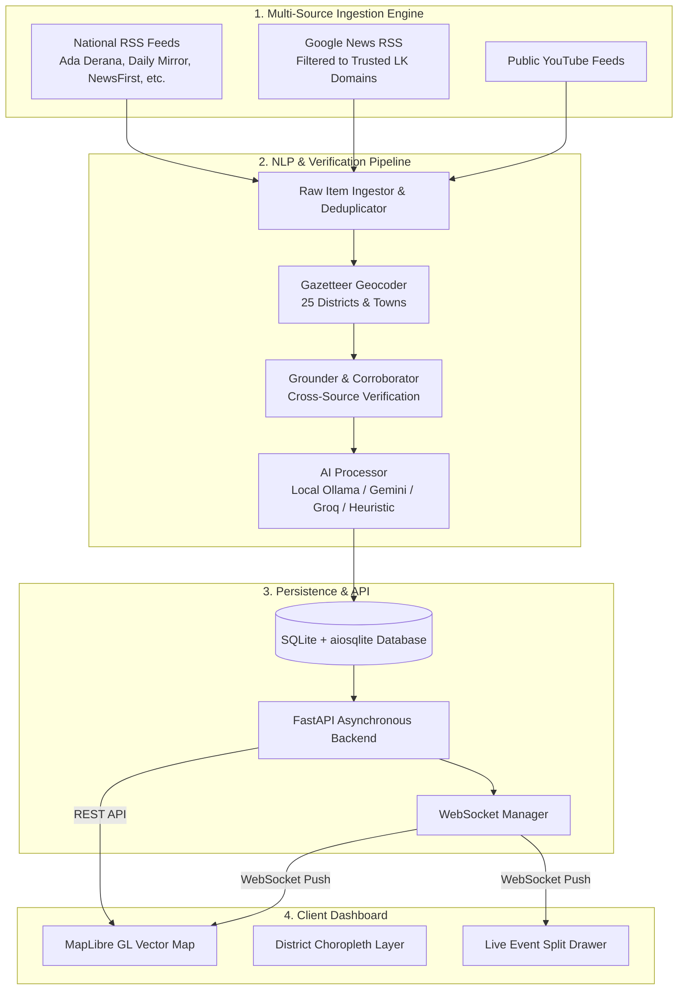

# NewsMapLK (LankaPulse) 🇱🇰

<p align="center">
  <strong>Real-Time, Location-Aware Breaking News Intelligence Map of Sri Lanka</strong>
</p>

<p align="center">
  <a href="#license"></a>
  
  
  
  
  
</p>

---

## 📌 Overview

**NewsMapLK** (powered by the **LankaPulse** engine) is an open-source, real-time news aggregation and geospatial visualization platform designed specifically for Sri Lanka.

It automatically monitors national news media across Sinhala, Tamil, and English, applies NLP/LLM extraction to detect incidents and geocode locations to Sri Lanka's 25 administrative districts, corroborates events across multiple independent news sources, and streams live breaking updates to an interactive, high-performance vector map interface via WebSockets.

Designed to be **100% runnable without paid API keys**, NewsMapLK supports local LLMs (via Ollama), built-in heuristic rule-based extraction, open vector tiles (OpenFreeMap), and open boundary data (geoBoundaries / OpenStreetMap).

---

## ✨ Key Features

- **🗺️ Real-Time Geospatial News Mapping**:
  - Interactive dark-mode vector map powered by [MapLibre GL JS](https://maplibre.org/) and OpenFreeMap tiles.
  - Interactive choropleth layer covering all 25 Sri Lankan administrative districts.
  - Custom Sri Lankan gazetteer containing hundreds of towns, intersections, and landmarks with GPS coordinates.

- **⚡ Live Streaming via WebSockets**:
  - Live incident push notifications to connected browsers over `/ws/events`.
  - Zero manual browser refreshing needed; automatically updates statistics and active incident clusters.

- **🤖 AI-Powered Entity & Timeline Extraction**:
  - Automatically identifies **what** happened, **where** (district + town), **when**, category, and confidence score.
  - Synthesizes key chronological timeline steps from raw news articles.
  - Generates multi-language headlines in **English**, **Sinhala (සිංහල)**, and **Tamil (தமிழ்)**.
  - Supports **Ollama** (e.g. `qwen2.5`, `llama3`), **Google Gemini**, **Groq**, and standard OpenAI-compatible endpoints.
  - Built-in heuristic fallback ensures the pipeline never halts even if an LLM is offline.

- **🔍 Multi-Source Corroboration & Verification**:
  - Cross-references incoming reports against publisher RSS feeds, Google News queries, and GDELT.
  - Flags single-source rumors vs multi-source confirmed breaking incidents with corroboration scores.

- **📰 Comprehensive Sri Lankan Media Ingestion**:
  - Continuous ingestion from trusted national outlets: *Ada Derana (EN/SI/TA)*, *Daily Mirror*, *NewsFirst*, *Daily FT*, *EconomyNext*, *The Island*, *BBC Sinhala*, *BBC Tamil*, and optional YouTube news channel feeds.

- **📱 Split-View Intelligence Drawer**:
  - Deep-dive panel with full chronological event progression, original source links, district metrics, and verification status.

---

## 🏛️ System Architecture



---

## 🚀 Quick Start Guide

### 1. Prerequisites
- **Python**: Version `3.10` or higher
- **Git**
- *(Optional)* **Ollama** installed locally if you wish to run fully local offline AI models (`ollama run qwen2.5:7b-instruct`).

### 2. Clone the Repository
```bash
git clone https://github.com/slmoonboy/newsmaplk.git
cd newsmaplk
```

### 3. Set Up Python Virtual Environment
```bash
python3 -m venv venv
source venv/bin/activate
# On Windows use: venv\Scripts\activate
```

### 4. Install Dependencies
```bash
pip install -r requirements.txt
```

*(Optional: If running headless browser scraping features)*
```bash
playwright install chromium
```

### 5. Configure Environment Variables
Copy the sample environment file to `.env`:
```bash
cp .env.example .env
```

Edit `.env` to suit your setup. **No API keys are required** by default — NewsMapLK defaults to free/open-source configurations. If you want to use cloud LLMs (Gemini or Groq), add your keys in `.env`:
```ini
# Google Gemini (Free Tier)
LLM_PROVIDER=gemini
GEMINI_API_KEY=your_gemini_api_key_here
LLM_MODEL=gemini-2.5-flash

# OR Groq (Free Tier)
# LLM_PROVIDER=groq
# GROQ_API_KEY=your_groq_api_key_here
# LLM_MODEL=llama-3.3-70b-versatile
```

### 6. (Optional) Seed Demo Data
To test the web interface immediately with realistic Sri Lankan incident samples:
```bash
python -m backend.seed_demo
```
*(To clear demo items later, pass `--clear`)*:
```bash
python -m backend.seed_demo --clear
```

### 7. Run the Application
Launch the server using Uvicorn:
```bash
uvicorn backend.main:app --host 0.0.0.0 --port 8000 --reload
```
Open your browser and navigate to:
- **Web Dashboard**: [http://localhost:8000](http://localhost:8000)
- **Interactive OpenAPI Docs**: [http://localhost:8000/docs](http://localhost:8000/docs)

---

## 📡 API Reference

| Method | Endpoint | Description |
| :--- | :--- | :--- |
| `GET` | `/` | Web application interactive map interface |
| `GET` | `/api/health` | Service uptime, database health, pipeline status, and LLM state |
| `GET` | `/api/events` | Query events (filter by `district`, `category`, `hours`, `limit`) |
| `GET` | `/api/events/{id}` | Retrieve single event detail with timeline steps & media reports |
| `GET` | `/api/districts` | Aggregated incident count and active events grouped by district |
| `GET` | `/api/sources` | Catalog of configured news feeds, trusted domains, and licenses |
| `POST` | `/api/pipeline/trigger` | Manually invoke an immediate ingestion & extraction cycle |
| `WS` | `/ws/events` | Real-time WebSocket event stream for live client updates |

---

## ⚙️ Configuration Reference

All settings can be customized in `.env` or system environment variables:

| Variable | Default | Description |
| :--- | :--- | :--- |
| `HOST` | `0.0.0.0` | Server bind address |
| `PORT` | `8000` | Server listening port |
| `LOG_LEVEL` | `INFO` | Logging verbosity (`DEBUG`, `INFO`, `WARNING`, `ERROR`) |
| `DATABASE_URL` | `sqlite+aiosqlite:///.../lankapulse.db` | SQLAlchemy async database connection URI |
| `ENABLE_PIPELINE` | `true` | Enable background ingestion & extraction workers |
| `POLL_INTERVAL_SECONDS`| `180` | Interval between news scraping cycles (in seconds) |
| `LLM_PROVIDER` | `auto` | LLM engine (`auto`, `ollama`, `gemini`, `groq`, `local`, `heuristic`) |
| `LLM_MODEL` | `qwen2.5:7b-instruct` | Model identifier for Ollama/Gemini/Groq |
| `MIN_CONFIDENCE` | `0.35` | Minimum geocoding/extraction confidence score threshold |
| `ENABLE_GROUNDING` | `true` | Corroborate incidents across Google News / Wikipedia / GDELT |

---

## 📂 Project Structure

```text
newsmaplk/
├── backend/
│   ├── ai_processor.py            # LLM prompt templates, JSON schema parser & heuristics
│   ├── config.py                  # Pydantic / dataclass settings loaded from .env
│   ├── geocoder.py                # Gazetteer-based local entity geocoding
│   ├── grounder.py                # Cross-publisher corroboration & verification
│   ├── ingestor.py                # RSS feed parsers and trusted news source aggregators
│   ├── main.py                    # FastAPI server, REST routes & WebSocket manager
│   ├── models.py                  # SQLAlchemy async database models (Event, MediaReport, etc.)
│   ├── pipeline.py                # Orchestration loop connecting ingest, process & store
│   ├── seed_demo.py               # Demo event dataset generator for UI development
│   └── sri_lanka_gazetteer.json   # Curated coordinate database of Sri Lankan towns/districts
├── frontend/
│   ├── app.js                     # MapLibre map controllers, WebSocket client & UI state
│   ├── index.html                 # Semantic HTML5 layout with drawer and stat counters
│   ├── styles.css                 # Dark-mode dashboard stylesheet with responsive drawer
│   └── sri-lanka-districts.geojson# Official district GeoJSON polygon boundaries
├── .env.example                   # Environment variable template
├── .gitignore                     # Git ignore rules for Python, SQLite & OS files
├── LICENSE                        # MIT License & Third-Party component notices
├── requirements.txt               # Backend Python dependencies
└── README.md                      # Project documentation
```

---

## 📜 Third-Party Data & Licenses

This application is built with pride using open data and open-source software:

- **OpenStreetMap & geoBoundaries**: District boundaries and geographic features are licensed under the [Open Data Commons Open Database License (ODbL 1.0)](https://opendatacommons.org/licenses/odbl/).
- **OpenFreeMap**: Open-source, community-hosted vector tiles.
- **Wikipedia**: Public summaries used for entity grounding are licensed under [CC BY-SA 4.0](https://creativecommons.org/licenses/by-sa/4.0/).
- **MapLibre GL JS**: Open-source vector mapping library licensed under the [BSD-3-Clause License](https://github.com/maplibre/maplibre-gl-js/blob/main/LICENSE.txt).

---

## ⚖️ License

Distributed under the **MIT License**. See [`LICENSE`](LICENSE) for complete details.

Copyright (c) 2026 [slmoonboy](https://github.com/slmoonboy)
